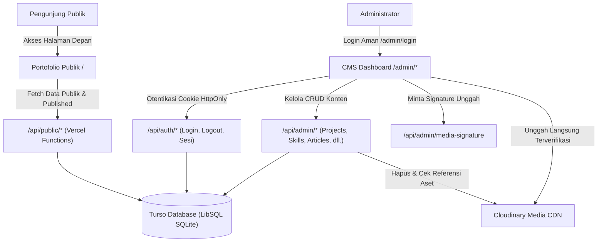

# Full CMS Portfolio — React, Turso, Cloudinary & Vercel

Situs portofolio web modern, responsif, dan berorientasi performa tinggi untuk Full-Stack Developer yang dilengkapi **CMS Administration Dashboard** terintegrasi penuh. Menggunakan basis data relasional **Turso (LibSQL)**, CDN media **Cloudinary**, serverless functions **Vercel**, serta antarmuka modern **React 19** dan **Tailwind CSS v4**.

---

## 🌟 Arsitektur Sistem & Alur Kerja



---

## 🛠️ Stack Teknologi

| Layer | Teknologi | Peran & Deskripsi |
| :--- | :--- | :--- |
| **Frontend UI** | [React.js](https://react.dev/) (v19) | Komponen fungsional modern & hooks |
| **Styling** | [Tailwind CSS v4](https://tailwindcss.com/) | Desain blue-tech dengan token warna terpusat |
| **Routing** | [React Router](https://reactrouter.com/) (v7) | Navigasi halaman publik & rute admin terproteksi |
| **Icons** | [Lucide React](https://lucide.dev/) | Ikon antarmuka modern dan tajam |
| **Markdown** | [Marked](https://marked.js.org/) + [DOMPurify](https://github.com/cure53/DOMPurify) | Parser artikel blog aman dari XSS |
| **Backend API** | [Vercel Serverless Functions](https://vercel.com/docs/functions) | RESTful API modular berbasis Node.js ES Modules |
| **Basis Data** | [Turso](https://turso.tech/) (@libsql/client) | Database SQLite terdistribusi berlatensi rendah |
| **Asset Storage** | [Cloudinary Node SDK](https://cloudinary.com/) | CDN gambar dengan upload signature aman |
| **Security** | [Bcryptjs](https://github.com/dcodeIO/bcrypt.js) & Web Crypto | Hashing password 12-round & token sesi SHA-256 |
| **Pengujian** | [Vitest](https://vitest.dev/) | Unit test & integrasi backend-frontend |
| **Linter** | [Oxlint](https://oxc.rs/) | Static analysis berkecepatan tinggi |

---

## 📁 Struktur Direktori

```text
├── api/                             # Backend Vercel Serverless Functions
│   ├── _lib/                        # Shared backend modules
│   │   ├── auth.js                  # Hashing password, sesi, cookie serializer
│   │   ├── cloudinary.js            # In-use reference checker & Cloudinary client
│   │   ├── db.js                    # Koneksi LibSQL / Turso client singleton
│   │   ├── http.js                  # JSON responses, error handler, CSRF guard
│   │   └── rateLimit.js             # Sliding-window rate limiter in-memory
│   ├── admin/                       # Protected CMS APIs (Require Auth Cookie)
│   │   ├── articles.js              # CRUD artikel teknis & blog
│   │   ├── experiences.js           # CRUD riwayat & milestone belajar
│   │   ├── media.js                 # CRUD aset media database
│   │   ├── media-signature.js       # Penandatanganan upload aman Cloudinary
│   │   ├── messages.js              # Manajemen pesan kontak pengunjung
│   │   ├── profile.js               # Pengaturan bio, kontak, & hero text
│   │   ├── projects.js              # CRUD proyek, slug validator & gallery
│   │   ├── settings.js              # Toggle fitur & metadata SEO
│   │   ├── skills.js                # CRUD keahlian teknis & visibilitas
│   │   └── stats.js                 # Statistik ringkasan dashboard
│   ├── auth/                        # Otentikasi Administrator
│   │   ├── login.js                 # Login terproteksi rate limit & HttpOnly cookie
│   │   ├── logout.js                # Revokasi sesi di DB & pembersihan cookie
│   │   └── session.js               # Verifikasi status login aktif
│   └── public/                      # Public Read-only APIs (Filtered)
│       ├── articles.js              # Menampilkan hanya artikel berstatus 'published'
│       ├── contact.js               # Formulir kontak dengan rate limiter ke Turso
│       ├── experiences.js           # Menampilkan hanya milestone 'is_visible = 1'
│       ├── profile.js               # Informasi bio publik tanpa data sensitif
│       ├── projects.js              # Menampilkan hanya proyek 'published'
│       ├── settings.js              # Pengaturan publik situs
│       └── skills.js                # Menampilkan hanya keahlian 'is_visible = 1'
├── db/
│   └── migrations/                  # Skrip migrasi DDL database Turso
│       └── 001_initial_schema.sql   # Skema tabel relasional lengkap & indeks
├── scripts/
│   ├── create-admin.js              # CLI provisioning akun administrator pertama
│   ├── migrate.js                   # Runner eksekusi migrasi DDL SQL ke Turso/SQLite
│   └── seed.js                      # Seeder data awal dari portofolio statis
├── src/
│   ├── components/
│   │   ├── admin/                   # Komponen dashboard CMS & ProtectedRoute
│   │   ├── layout/                  # Navbar publik & Footer
│   │   ├── sections/                # Hero, About, Skills, Projects, Articles, Journey, Contact
│   │   └── ui/                      # Button, Card, Badge, Icons, SectionHeading
│   ├── context/
│   │   ├── AuthContext.jsx          # Context sesi login administrator
│   │   └── PortfolioContext.jsx     # Context sinkronisasi data publik Turso
│   ├── pages/
│   │   ├── admin/                   # Halaman Overview, Projects, Media, Profile, dll.
│   │   └── public/                  # PublicPortfolio page
│   ├── services/                    # Abstraksi request fetch ke /api/*
│   ├── index.css                    # Tailwind CSS v4 design tokens
│   ├── App.jsx                      # Client Router (React Router v7) & Code-splitting
│   └── main.jsx                     # Entry React DOM
├── tests/
│   └── backend_cms.test.js          # Pengujian integrasi API, security & database
├── vercel.json                      # Konfigurasi Vercel SPA rewrites & security headers
├── vite.config.js                   # Konfigurasi Vite & API dev server middleware
└── .env.example                     # Contoh template variabel lingkungan
```

---

## ⚡ Panduan Instalasi & Menjalankan Lokal

### 1. Prasyarat
- **Node.js**: v18.0.0 atau lebih baru (Disarankan Node.js v20+ / v22+).
- **Git** terpasang di komputer Anda.

### 2. Kloning atau Buka Direktori Proyek
```bash
git clone https://github.com/faza-magala/portofolio.git
cd portofolio
```

### 3. Instalasi Dependensi
```bash
npm install
```

### 4. Konfigurasi Environment Variables
Salin file `.env.example` menjadi `.env`:
```bash
cp .env.example .env
```
Untuk pengembangan lokal, file `.env` dapat dibiarkan kosong karena sistem secara otomatis menggunakan fallback database SQLite lokal (`portfolio.db`).

### 5. Jalankan Migrasi & Seeding Data Awal
Eksekusi migrasi untuk membentuk tabel di Turso / SQLite lokal:
```bash
npm run db:migrate
```
Isi data awal dari konten Tisna Rizqiana yang telah ada:
```bash
npm run db:seed
```

### 6. Buat Akun Administrator Pertama
Gunakan skrip CLI bawaan untuk membuat kredensial admin:
```bash
npm run admin:create admin@example.com PasswordAman123!
```

### 7. Jalankan Server Pengembangan
```bash
npm run dev
```
Buka browser di:
- **Portofolio Publik**: [http://localhost:5173](http://localhost:5173)
- **CMS Administration**: [http://localhost:5173/admin/login](http://localhost:5173/admin/login)

---

## ☁️ Integrasi Turso Database & Cloudinary

### Setup Database Turso (Cloud)
1. Kunjungi [Turso.tech](https://turso.tech/) dan buat akun.
2. Buat basis data baru:
   ```bash
   turso db create portfolio-db
   ```
3. Dapatkan Database URL:
   ```bash
   turso db show portfolio-db --url
   ```
4. Buat token autentikasi:
   ```bash
   turso db tokens create portfolio-db
   ```
5. Masukkan ke file `.env` atau Vercel Environment Variables:
   ```env
   TURSO_DATABASE_URL=libsql://portfolio-db-username.turso.io
   TURSO_AUTH_TOKEN=eyJh...
   ```
6. Terapkan skema ke database Turso:
   ```bash
   npm run db:migrate
   npm run db:seed
   ```

### Setup Cloudinary (Media CDN)
1. Kunjungi [Cloudinary.com](https://cloudinary.com/) dan buat akun gratis.
2. Buka dashboard Cloudinary dan salin:
   - **Cloud Name**
   - **API Key**
   - **API Secret**
3. Masukkan ke file `.env` atau Vercel Environment Variables:
   ```env
   CLOUDINARY_CLOUD_NAME=your_cloud_name
   CLOUDINARY_API_KEY=your_api_key
   CLOUDINARY_API_SECRET=your_api_secret
   ```
*Catatan Keamanan: API Secret Cloudinary hanya tersimpan di backend (serverless function) dan tidak pernah dibocorkan ke client bundle.*

---

## 🔒 Fitur Keamanan Sistem (Defense in Depth)

1. **Otentikasi & Sesi Kuat**:
   - Password di-hash menggunakan algoritma **Bcrypt** dengan salt 12 rounds.
   - Token sesi dibuat secara kriptografis (`crypto.randomBytes(32)`), lalu disimpan dalam bentuk hash **SHA-256** di database Turso.
   - Sesi dikirimkan melalui cookie browser dengan atribut `HttpOnly`, `SameSite=Lax`, `Path=/`, dan `Secure` pada mode produksi.
2. **Proteksi CSRF & Origin**:
   - Setiap mutasi data (`POST`, `PUT`, `DELETE`) memvalidasi header `Origin`, `Referer`, dan `X-Requested-With`.
3. **Sliding-Window Rate Limiting**:
   - Endpoint `/api/auth/login` dibatasi maksimal 5 percobaan per 15 menit per alamat IP untuk mencegah brute-force.
   - Endpoint `/api/public/contact` dibatasi maksimal 5 pesan per jam per IP guna menangkal spam.
4. **Proteksi Referensi Media**:
   - Sebelum menghapus aset dari Cloudinary, backend memverifikasi apakah aset sedang digunakan oleh proyek, artikel, atau foto profil. Penghapusan dibatalkan jika aset masih memiliki referensi aktif.
5. **Privasi Konten Draf**:
   - Endpoint publik `/api/public/projects` dan `/api/public/articles` secara tegas hanya mengembalikan data dengan status `published`. Draf tidak pernah bocor ke publik.
6. **Sanitasi Konten Artikel**:
   - Konten Markdown artikel disanitasi menggunakan pustaka **DOMPurify** sebelum dirender ke HTML untuk mencegah serangan Cross-Site Scripting (XSS).

---

## 🧪 Pengujian & Kualitas Kode

Eksekusi seluruh unit test dan pengujian integrasi:
```bash
npm test
```
*Hasil: 18 unit tests & integration tests lulus 100%.*

Eksekusi analisis statis / linter:
```bash
npm run lint
```

Eksekusi build produksi:
```bash
npm run build
```

---

## 🚀 Panduan Deployment ke Vercel

Aplikasi ini telah dikonfigurasi penuh untuk Vercel Serverless Functions dan Vite SPA.

### Langkah-langkah:
1. Dorong kode ke repositori GitHub Anda:
   ```bash
   git add .
   git commit -m "feat: implementasi lengkap CMS Portfolio dengan Turso, Cloudinary, dan Vercel"
   git push origin main
   ```
2. Buka dashboard [Vercel](https://vercel.com/) dan pilih **Add New Project**.
3. Hubungkan repositori GitHub Anda.
4. Pada bagian **Environment Variables**, tambahkan variabel berikut:
   - `TURSO_DATABASE_URL`
   - `TURSO_AUTH_TOKEN`
   - `CLOUDINARY_CLOUD_NAME`
   - `CLOUDINARY_API_KEY`
   - `CLOUDINARY_API_SECRET`
   - `SESSION_SECRET`
   - `ADMIN_EMAIL`
   - `ADMIN_PASSWORD`
5. Tekan **Deploy**. Vercel akan otomatis membangun bundel React di direktori `dist` dan menyiapkan serverless functions pada rute `/api/*`.
6. Akses dashboard CMS Anda di `https://your-domain.vercel.app/admin/login` menggunakan kredensial admin yang telah diprovisi.

---

## 📄 Lisensi
Proyek ini dibuat untuk keperluan portofolio profesional dan pembelajaran rekayasa perangkat lunak. Bebas digunakan dan dimodifikasi.
